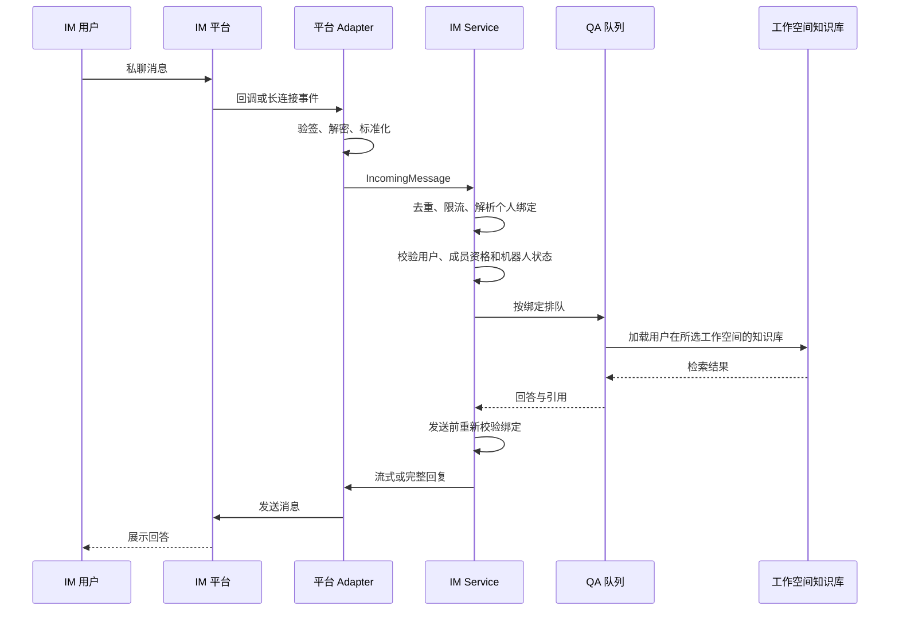

# IM 集成（IM Integration）

IM 集成让用户直接在企业微信、飞书、Lark、Slack、Telegram 或钉钉中使用自己的 WeKnora 工作空间知识库。第三方机器人由系统管理员统一创建和维护，普通用户只需完成一次账号绑定。

<Screenshot
  src="/screenshots/im-channels.png"
  caption="系统级 IM 机器人配置"
  hint="展示系统管理中的机器人列表和配置表单，包括平台、接入模式、输出模式与凭据。" />

## 使用流程

### 系统管理员：配置机器人

1. 在第三方平台创建应用或机器人并取得所需凭据。
2. 进入 **设置 → 系统管理 → IM 机器人**。
3. 新建机器人，选择平台、接入模式和输出模式，填写凭据后启用。
4. Webhook 模式还需把机器人卡片中的回调地址配置到第三方平台；WebSocket 或长轮询模式无需公网回调地址。

系统机器人是全局配置，不绑定用户、工作空间、Agent 或知识库。凭据只对系统管理员可见，普通用户看到的机器人列表不包含凭据。

### 普通用户：绑定自己的账号

1. 进入 **设置 → 集成 → IM**。
2. 选择一个已启用的机器人和自己的工作空间。
3. 生成有效期为 5 分钟的一次性绑定码。
4. 在对应客户端中私聊机器人，直接发送完整的 `WK-...` 绑定码。
5. 页面显示绑定成功后，即可在该私聊中提问。

绑定码是普通文本，不依赖 `/bind` 等命令，因此适用于不支持斜杠命令的客户端。绑定码只能使用一次，服务端仅保存其 SHA-256 哈希。

## 支持范围

| 平台 | 系统机器人配置 | 个人绑定 | 常用接入模式 |
| --- | --- | --- | --- |
| 企业微信 | 支持 | 支持 | WebSocket / Webhook |
| 飞书 | 支持 | 支持 | WebSocket / Webhook |
| Lark | 支持 | 支持 | WebSocket / Webhook |
| Slack | 支持 | 支持 | WebSocket / Webhook |
| Telegram | 支持 | 支持 | 长轮询 / Webhook |
| 钉钉 | 支持 | 支持 | Stream / Webhook |
| 微信 | 支持配置 | 暂不支持 | 长轮询 |
| QQ 机器人 | 支持配置 | 暂不支持 | WebSocket |

Mattermost 和云之家不在当前适配范围内。

个人绑定当前只接受私聊。群聊消息会收到明确提示，不会进入问答流程，也不会创建会话。

## 工作空间与知识库范围

每条有效绑定同时关联以下身份：

- 第三方平台验证后的用户 ID
- WeKnora 用户
- 用户主动选择的工作空间
- 系统机器人

问答只会使用用户所选工作空间内可访问、非临时且支持快速问答的知识库。机器人配置本身不保存知识库范围，也不使用 Agent 配置决定权限。

收到消息后，服务端会校验绑定、用户状态、工作空间成员资格和机器人状态。排队任务执行前以及结果发送前还会再次校验；用户解绑、退出工作空间或机器人被停用后，未完成的结果不会继续发送。

## 消息处理

平台 Adapter 只负责平台协议差异，包括签名验证、消息解析、文件下载和回复发送。用户身份、工作空间权限、会话和问答流程由统一的 IM Service 处理。

## 会话规则

每个有效绑定只有一个当前会话，服务端以真实的 WeKnora 用户身份创建和访问会话。用户在不同机器人或不同工作空间中的绑定相互隔离。

- `/clear` 会清除当前会话映射，下一条消息创建新会话。
- 解绑会立即撤销当前绑定并关闭其会话映射。
- 重新绑定后会创建新的会话，不会继续使用已撤销绑定的上下文。

## 文件与图片

支持下载附件的平台会把文件或图片作为当前问题的上下文交给模型。附件不会自动写入知识库，也不会改变用户已有的知识库范围。

解析出的附件文本最多保留前 500 行且不超过 32 KiB；文件超过 32 MiB、下载失败或平台不支持下载时，机器人会返回明确提示。

知识库回答中的图片必须能被 IM 客户端通过公网 HTTP 地址访问。可使用公网对象存储地址，或配置 `APP_EXTERNAL_URL` 让 WeKnora 通过 `/r/` 短链接转发资源。

## 内置命令

账号绑定不依赖命令。完成绑定后，可以在私聊中使用以下辅助命令：

| 命令 | 作用 |
| --- | --- |
| `/help` | 查看可用命令 |
| `/info` | 查看当前绑定的工作空间、知识库范围和输出模式 |
| `/search <关键词>` | 在绑定范围内检索原文片段 |
| `/stop` | 停止当前排队或生成中的回答 |
| `/clear` | 清除当前对话上下文 |

`/stop` 不受普通消息限流影响，确保用户可以及时终止任务。其他命令仍按普通消息规则处理。

## 多实例部署

配置 Redis 后，IM 模块会协调以下跨实例状态：

- WebSocket 和长轮询机器人的单实例连接领导权
- 消息去重与用户限流
- 单用户排队数量和全局并发数量
- 跨实例停止信号与执行中任务定位

没有 Redis 时使用本地内存状态，适用于单实例部署。

## 安全边界

- Webhook 回调不使用 WeKnora 登录态，由各平台的签名、Token 或加密机制验证。
- 绑定关系只接受平台验证后的发送者 ID，客户端不能自行声明 WeKnora 用户或工作空间。
- 同一机器人下，一个外部用户只能绑定一个 WeKnora 账号，一个 WeKnora 账号也只能绑定一个外部身份。
- 系统管理员停用、删除机器人或修改机器人核心身份时，相关绑定和待处理绑定码会失效。
- 普通用户只能查看和解除自己的绑定。

## 相关代码

- 核心编排：`internal/im/service.go`、`internal/im/binding.go`
- 平台适配器：`internal/im/{wecom,feishu,slack,telegram,dingtalk,wechat,qqbot}/`
- HTTP 接口：`internal/handler/im.go`、`internal/handler/wechat_qrcode.go`
- 路由：`internal/router/routes_agent.go` 中的 `RegisterIMRoutes` 和 `RegisterIMChannelRoutes`
- 前端入口：`frontend/src/components/IMChannelManager.vue`、`frontend/src/components/IMBindingPanel.vue`
